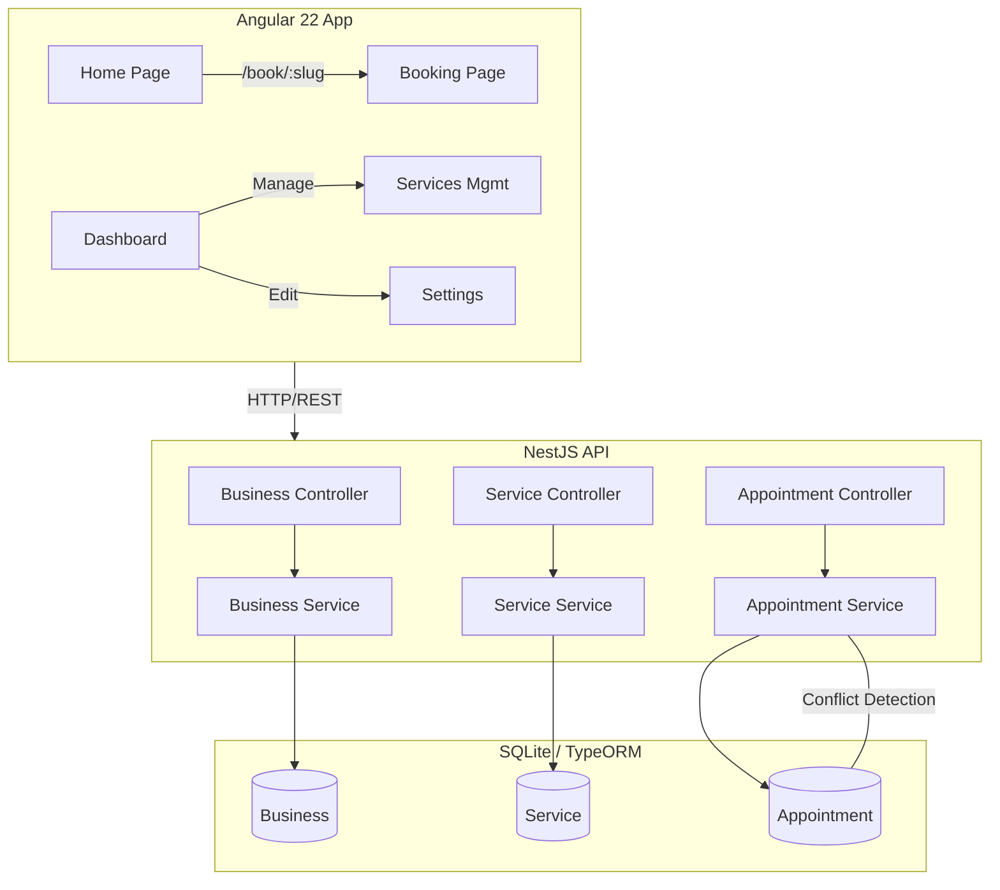

# Architecture

## System Diagram



## Data Flow

### Booking Flow
```
Customer selects business → Lists services → Picks date/time
→ Enters contact info → POST /api/appointments
→ Backend validates (conflict check + service duration)
→ Returns 201 (created) or 409 (conflict)
→ Customer sees confirmation or error
```

### Dashboard Flow
```
Owner visits /dashboard/:slug → GET /api/appointments?businessId=&date=
→ Backend queries appointments for that business+date
→ Renders list with status badges
→ Owner can cancel or complete via PATCH
```

## Module Architecture (NestJS)

Each feature follows the standard NestJS module pattern:

```
business/
├── business.entity.ts      → TypeORM entity
├── business.service.ts     → Business logic
├── business.controller.ts  → REST endpoints
├── business.module.ts      → Module definition
└── dto/
    └── create-business.dto.ts
```

## Why This Architecture

- **Separation of concerns**: Thin controllers delegate to service layer
- **Testability**: Services can be tested with mock repositories
- **Scalability**: Feature modules can be independently extended
- **Swagger**: Auto-generated API docs via decorators
