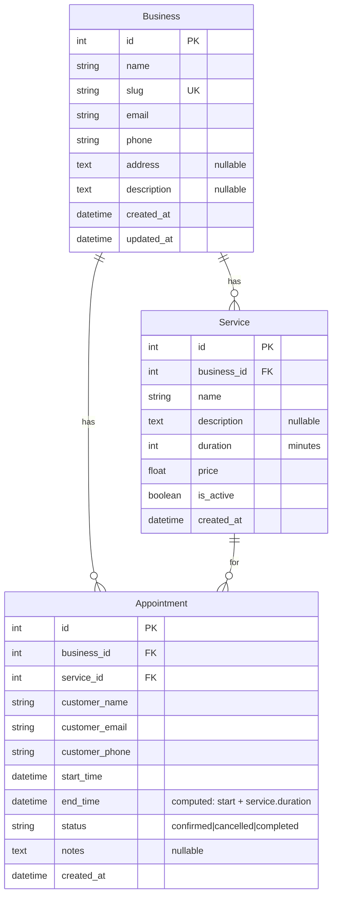

# Database

## Schema



## Migration Strategy

Currently using TypeORM `synchronize: true` for development — entities are auto-synced to schema on startup.

**For production**, create migration files:

```bash
# Generate migration from entity changes
npx typeorm migration:generate src/migrations/SnakeName -d src/config/typeorm.config.ts

# Run migrations
npx typeorm migration:run -d src/config/typeorm.config.ts
```

## Neon / PostgreSQL Upgrade

The architecture is Neon-ready. To switch to PostgreSQL:

1. Install `pg` and `@nestjs/typeorm` (already compatible)
2. Change TypeORM config to `type: 'postgres'`
3. Set `DATABASE_URL` to the Neon connection string
4. Disable `synchronize` and use migrations
5. Enable `pgvector` extension on Neon for semantic search capabilities

```typescript
// apps/api/src/app.module.ts — Neon config
TypeOrmModule.forRootAsync({
  useFactory: (config: ConfigService) => ({
    type: 'postgres',
    url: config.get<string>('DATABASE_URL'),
    entities: [__dirname + '/**/*.entity{.ts,.js}'],
    synchronize: false,
    ssl: { rejectUnauthorized: false },
  }),
  inject: [ConfigService],
}),
```

## SQL Performance

The key performance-critical query is **conflict detection**:

```typescript
// Find overlapping confirmed appointments
this.appointmentRepository.find({
  where: {
    businessId: dto.businessId,
    status: 'confirmed',
    startTime: LessThan(endTime),   // existing starts before new ends
    endTime: MoreThan(startTime),   // existing ends after new starts
  },
});
```

This is O(n) on the business's confirmed appointments for that time window. For production with many appointments, add a composite index on `(businessId, status, startTime, endTime)`.
